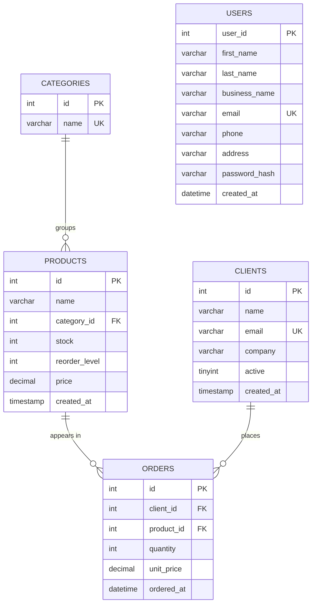

# BFB321 Inventory

A Flask web application for managing a small business's inventory, backed by a MySQL database.
It is the practical project for **BFB321 Class 5 – Connecting Flask to a MySQL Database**
(Supply Chain Technology Module).

Every number on screen is calculated from the database: revenue, conversion rate, stock status,
the monthly revenue chart, ABC classification and EOQ.

## Features

| Page | What it does |
|---|---|
| **Overview** `/` | Revenue for the last 30 days (with growth vs the 30 days before), active clients, conversion rate, restock alerts, a 6-month revenue chart and the product list with status badges |
| **Products** `/products` | Search by name, filter by category, add, edit and delete products. A product that already has orders cannot be deleted |
| **Clients** `/clients` | Add clients (unique email), activate / deactivate them, see order count and total spent |
| **Orders** `/orders` | Place an order: the order is saved and the stock is reduced in **one transaction**. Orders for more than the available stock are refused |
| **Reports** `/reports` | ABC classification by revenue and Economic Order Quantity (EOQ) with adjustable ordering and holding costs |
| **Users** `/users`, `/register` | Business registration with hashed passwords |

Stock status is calculated from `stock` and `reorder_level`, never typed by hand:

| Condition | Status |
|---|---|
| `stock = 0` | Out of stock |
| `stock <= reorder_level` | Restock |
| `stock <= reorder_level × 2` | Low stock |
| otherwise | In stock |

## Tech stack

- Python 3.10+ and Flask
- MySQL 8 (Aiven cloud database), accessed with PyMySQL
- Jinja2 templates and plain CSS
- python-dotenv for configuration

## Project structure

```
FLASK/
├── app.py              routes: reads the request, calls models, renders templates
├── models.py           SQL queries and business rules (no HTML)
├── db.py               connection to MySQL, one connection per request, query helpers
├── init_db.py          creates the tables and loads the sample data
├── schema.sql          CREATE TABLE statements
├── seed.sql            sample data (4 categories, 10 products, 7 clients, 30 orders)
├── requirements.txt    Python packages
├── .env.example        template for your .env file
├── templates/          base, index, products, product_form, clients, orders,
│                       reports, register, users
├── static/css/style.css
└── docs/               Class 5 slides (PowerPoint)
```

Each layer has one job: `app.py` never contains SQL and `models.py` never touches HTML.

```
Browser → app.py (route) → models.py (SQL + rules) → db.py (connection) → MySQL
```

## Database

### Entity relationship diagram



`orders` links clients and products (a many-to-many relationship). `users` stands alone and is
used only by the registration pages.

### Schema

The full definitions are in [schema.sql](schema.sql).

**categories**: one row per category, so a name is stored only once.

| Column | Type | Rules |
|---|---|---|
| id | INT | primary key, auto increment |
| name | VARCHAR(80) | required, unique |

**products**: what we sell.

| Column | Type | Rules |
|---|---|---|
| id | INT | primary key, auto increment |
| name | VARCHAR(120) | required |
| category_id | INT | required, foreign key → `categories.id` |
| stock | INT | default 0, `CHECK (stock >= 0)` |
| reorder_level | INT | default 10, `CHECK (reorder_level >= 0)` |
| price | DECIMAL(10,2) | required, `CHECK (price >= 0)` |
| created_at | TIMESTAMP | defaults to now |

**clients**: who buys. Clients are deactivated rather than deleted, so their order history is kept.

| Column | Type | Rules |
|---|---|---|
| id | INT | primary key, auto increment |
| name | VARCHAR(120) | required |
| email | VARCHAR(160) | required, unique |
| company | VARCHAR(160) | optional |
| active | TINYINT(1) | 1 = active, 0 = inactive, default 1 |
| created_at | TIMESTAMP | defaults to now |

**orders**: what was bought. `unit_price` copies the product price at the time of the order, so a later price change never rewrites history.

| Column | Type | Rules |
|---|---|---|
| id | INT | primary key, auto increment |
| client_id | INT | required, foreign key → `clients.id` |
| product_id | INT | required, foreign key → `products.id` |
| quantity | INT | required, `CHECK (quantity > 0)` |
| unit_price | DECIMAL(10,2) | required, `CHECK (unit_price >= 0)` |
| ordered_at | DATETIME | defaults to now |

**users**: business accounts for the registration pages.

| Column | Type | Rules |
|---|---|---|
| user_id | INT | primary key, auto increment |
| first_name, last_name | VARCHAR(100) | required |
| business_name | VARCHAR(150) | required |
| email | VARCHAR(255) | required, unique |
| phone | VARCHAR(30) | required |
| address | VARCHAR(500) | required |
| password_hash | VARCHAR(255) | Werkzeug hash, never the plain password |
| created_at | DATETIME | defaults to now |

## How to run the application

### 1. Get the code

```bash
git clone <your-repository-url>
cd FLASK
```

### 2. Create a virtual environment and install the packages

```bash
python -m venv .venv

# Windows
.venv\Scripts\activate
# macOS / Linux
source .venv/bin/activate

pip install -r requirements.txt
```

Your terminal prompt starts with `(.venv)` when the environment is active.

### 3. Configure the database connection

Copy the template and fill in your own values from the Aiven console (**Service → Overview → Connection information**):

```bash
copy .env.example .env      # Windows
cp .env.example .env        # macOS / Linux
```

```ini
DB_HOST=your-service-name-your-project.a.aivencloud.com
DB_PORT=12345
DB_USER=avnadmin
DB_PASSWORD=your-password
DB_NAME=inventory
SECRET_KEY=any-long-random-text
```

`.env` holds your password and is listed in `.gitignore`. Never commit it.

### 4. Create the tables and load the sample data

```bash
python init_db.py
```

Expected output:

```
Creating tables from schema.sql ...
Loading sample data from seed.sql ...
  categories 4 rows
  products   10 rows
  clients    7 rows
  orders     30 rows
Done. Now run:  python app.py
```

Running it again is safe, because sample data is only loaded when the `products` table is empty.
To start again from scratch (this **deletes all data**):

```bash
python init_db.py --reset
```

### 5. Start the app

```bash
python app.py
```

Open <http://127.0.0.1:5000> in your browser. Stop the server with `Ctrl+C`.
Restart it after changing `.env`.

## Quick test

With fresh sample data you should see:

- **Overview:** revenue R12,279 for the last 30 days, 6 active clients and 2 restock alerts (Monitor 27 and USB-C Hub)
- **Orders:** 3 × Monitor 27 succeeds and its stock drops from 12 to 9. An order for 500 is refused and nothing changes
- **Products:** deleting BFB321 is refused because it has orders
- **Clients:** adding a second client with an existing email is refused
- **Reports:** a holding cost of 0% shows an error and falls back to 20%

## Troubleshooting

| Message | Fix |
|---|---|
| `Can't connect to MySQL server ... timed out` | The Aiven service is asleep: power it on and wait for **Running**. Check `DB_HOST` and `DB_PORT` |
| `Access denied for user` | `DB_USER` or `DB_PASSWORD` is wrong |
| `Unknown database` | `DB_NAME` must be `inventory` |
| `'cryptography' package is required` | Run `pip install -r requirements.txt` with the virtual environment active |
| `No module named 'flask'` / `'pymysql'` | The virtual environment is not active |
| `Table doesn't exist` after editing `schema.sql` | Run `python init_db.py --reset` |

## Course material

The Class 5 slides that walk through building this project step by step are in
[docs/Flask_Class5_MySQL_Inventory.pptx](docs/Flask_Class5_MySQL_Inventory.pptx).
